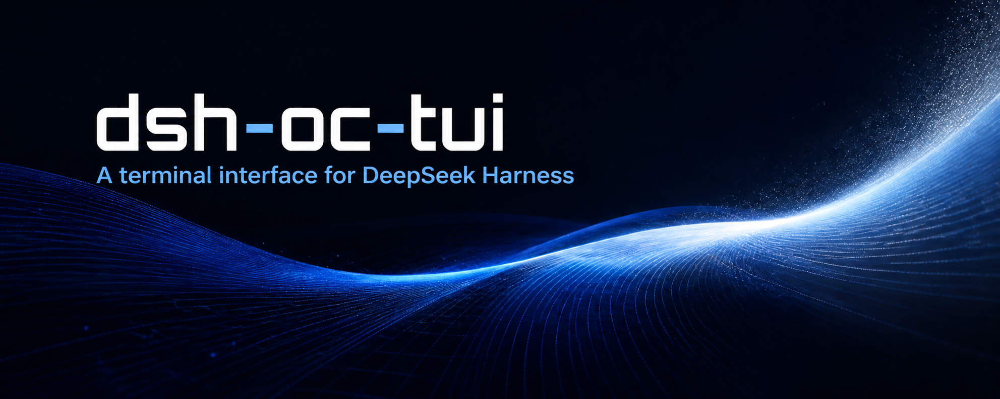
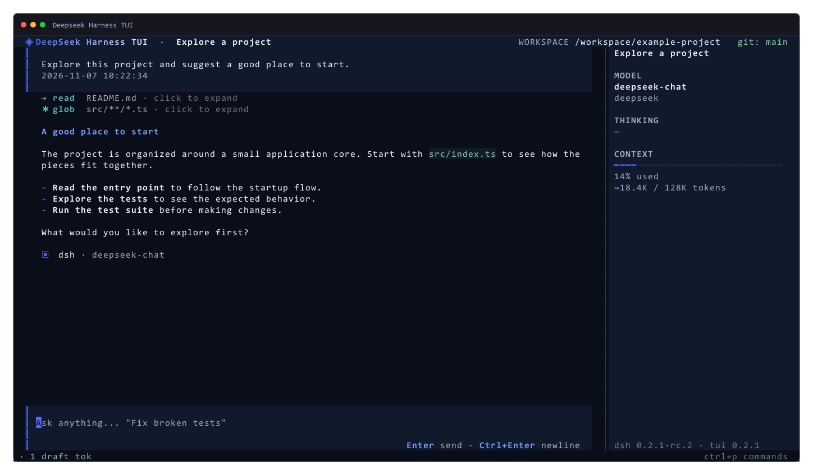
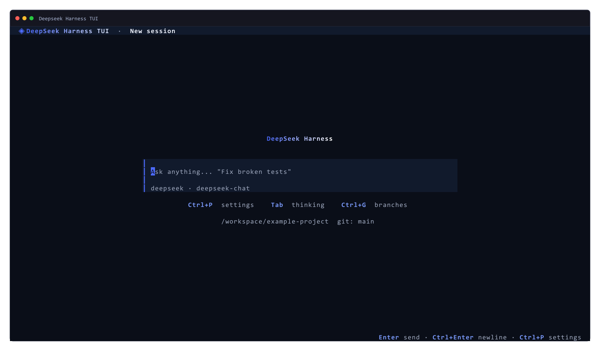
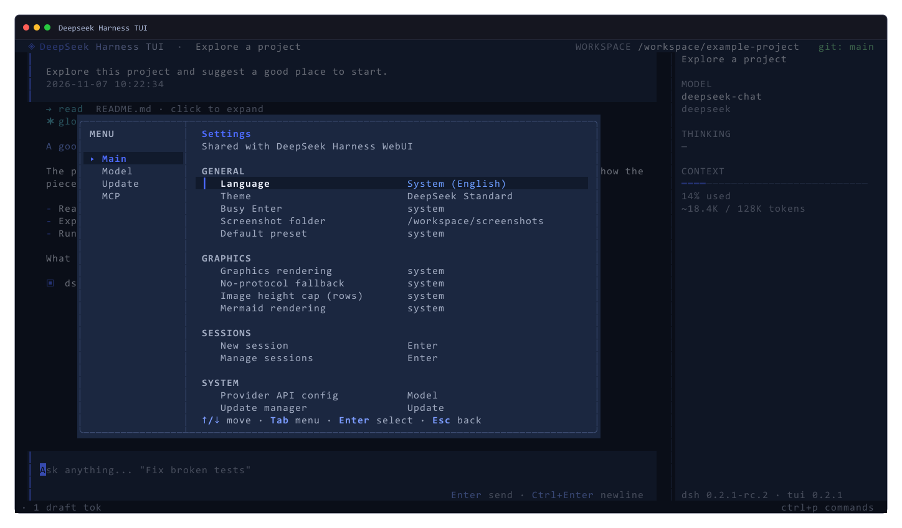

# dsh-oc-tui

**A terminal interface for [DeepSeek Harness](https://github.com/deepseek-ai/deepseek-harness).**
Chat with your agent, follow its work, and manage sessions without leaving your terminal.

[](https://www.npmjs.com/package/dsh-oc-tui)
[](https://awesome-dsh-plugin.com/zh/p/rayafriandion/dsh-oc-tui/)
[](LICENSE)
[](https://nodejs.org)

[English guide](docs/user-guide.md) · [中文用户手册](docs/用户手册.md) · [npm](https://www.npmjs.com/package/dsh-oc-tui) · [Plugin marketplace](https://awesome-dsh-plugin.com/zh/p/rayafriandion/dsh-oc-tui/)

## A clearer view of your agent

- **Stay in the flow.** Read streaming replies, reasoning, tool activity, Markdown, images, and Mermaid diagrams in one conversation.
- **Pick up where you left off.** Create, resume, and rewind durable sessions; inspect context usage and session statistics.
- **Make it yours.** Choose from five themes and 17 languages, manage models and MCP servers, and adjust thinking intensity in the app.
- **Work with the harness.** Approvals, interactive questions, commands, and tool execution remain part of DeepSeek Harness.

## See it in action



| Start a session | Configure your workspace |
| :---: | :---: |
|  |  |

*Captured with the TUI's built-in `Ctrl+S` screenshot feature using demonstration data.*

## Get started

You need Node.js `^22.19` or `>=24`, the `dsh` CLI, `pnpm`, an interactive terminal, and a configured model route. See the [installation guide](docs/user-guide.md#requirements) for compatibility and setup details.

```sh
dsh plugin --profile tui add -w dsh-oc-tui
dsh --profile tui
```

Type your first message to start a session. Use `Ctrl+P` for settings, `Tab` to change thinking intensity, and `Ctrl+S` to save a screenshot.

For installation options, shortcuts, settings, troubleshooting, and development, read the [English guide](docs/user-guide.md) or [中文用户手册](docs/用户手册.md).

## License

[LGPL-3.0-or-later](LICENSE).
